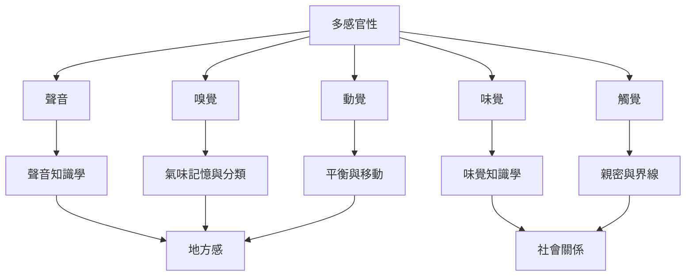

這張地圖將聲音、氣味、味覺、觸覺與動覺放進同一張關係圖。研究重點不是替每一種感官建立孤立章節，而是分析感官線索如何共同構成地方、記憶、知識與行動。

概念入口：[[多感官性]]、[[跨感官性]]、[[聲音知識學]]、[[聲景]]、[[嗅覺]]、[[味覺知識學]]、[[動覺]]、[[地方感]]。

永久筆記：[[聲音能生成地方知識]]、[[氣味分類會受到語言與生活環境塑造]]、[[飲食是多感官的知識實踐]]、[[觸覺同時建立親密與社會界線]]、[[感官經驗不是感官項目的加總]]。

研究材料：[[Kaluli的聲音世界把森林轉化為可知的地方]]、[[雨林聲學知識揭示聲音與地方彼此生成]]、[[嗅覺語言差異揭示氣味認知的文化生態脈絡]]、[[食物感官研究連結家庭邊界記憶與儀式]]、[[觸覺歷史揭示親密界線與權力的變化]]。

延伸實作：[[用氣味線索開啟地方記憶訪談]]、[[把共同備餐變成多感官關係研究]]、[[用聲音地圖揭示公共空間的時間差異]]。

本主題導讀：[[Sensory_Anthropology]]。
