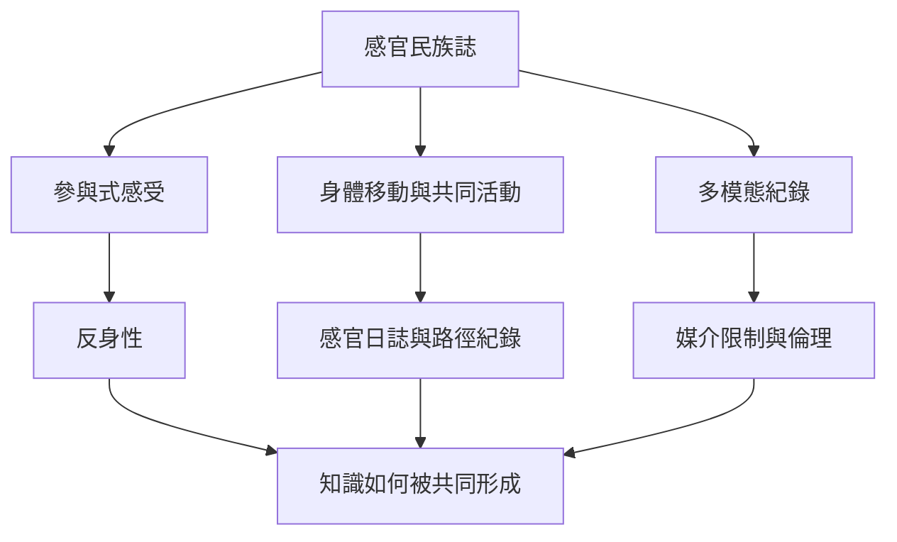

感官民族誌把研究者的身體參與納入知識生產，並要求反身性、共同活動、脈絡化紀錄與謹慎的多媒體呈現。方法不只是增加錄音或影像，而是重新思考「如何在場、如何感受、如何與他人共同理解」。

概念入口：[[感官民族誌]]、[[參與式感受]]、[[反身性]]、[[多模態民族誌]]、[[現象學]]。

永久筆記：[[感官民族誌要求研究者反思自身的感知位置]]、[[多模態紀錄不能等同於感受本身]]、[[感官經驗不是感官項目的加總]]。

研究材料：[[感官民族誌以共同感受取代純粹旁觀]]、[[感官民族誌必須重新思考訪談與多媒體呈現]]。

延伸實作：[[用感官散步建立城市的日常田野檔案]]、[[在田野筆記中區分感覺命名與解釋]]、[[用跨感官閱讀路徑理解一個地方]]。

本主題導讀：[[Sensory_Anthropology]]。
