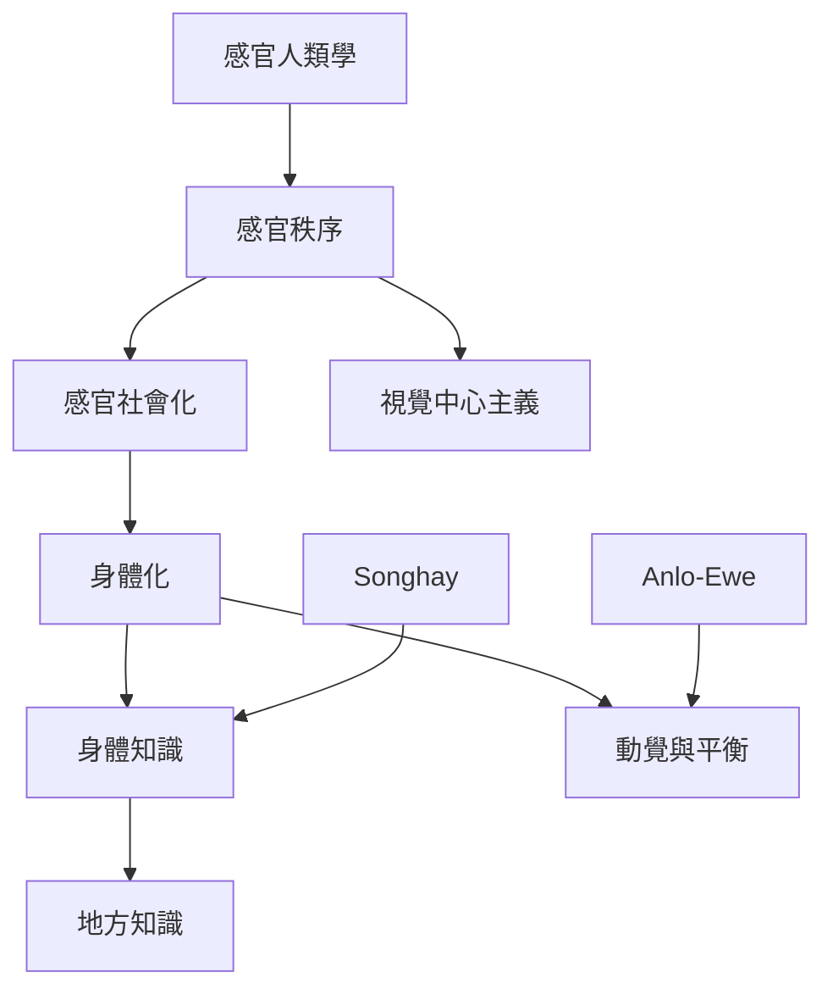

這張地圖整理感官人類學的核心理論：感官分類並非自然且固定，而是在社會化、身體化與權力關係中形成。它連結 Anlo-Ewe 的身體感受、Songhay 的身體知識，以及對西方五感模型的批判。

概念入口：[[感官人類學]]、[[感官秩序]]、[[身體化]]、[[身體知識]]、[[動覺]]、[[視覺中心主義]]、[[感官社會化]]。

永久筆記：[[感官不是固定的器官清單]]、[[每個社會都會形成自己的感官秩序]]、[[身體感受本身可以構成知識]]、[[感官能力是在社會化中習得的]]、[[動覺與平衡可能承載社會道德]]、[[感官秩序具有歷史性]]。

研究材料：[[Anlo-Ewe的身體感受包含平衡與動覺]]、[[Songhay知識透過身體與感官實踐傳遞]]、[[非洲感官心理學重新理解身體心智與知識]]。

延伸實作：[[建立一週感官日誌以辨識注意力的習慣]]、[[把行走路線當成動覺民族誌的資料]]。

本主題導讀：[[Sensory_Anthropology]]。
