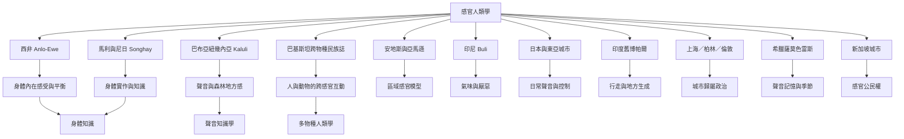

感官人類學的跨地域案例顯示，感官分類與身體知識具有地方性，但不應將單一社群當成整個地區的代表。此地圖以西非 Anlo-Ewe、馬利與尼日的 Songhay、巴布亞紐幾內亞 Kaluli、安地斯與亞馬遜、印尼、日本、印度、新加坡、上海／柏林／倫敦、希臘，以及巴基斯坦的人與動物關係作為互相對話的案例。

概念入口：[[感官人類學]]、[[身體知識]]、[[聲音知識學]]、[[多物種人類學]]、[[地方感]]。

研究材料：[[安地斯與亞馬遜的感官模型呈現不同的文化分類]]、[[印尼Buli社群的氣味與厭惡交織成道德秩序]]、[[日本日常聲音揭示感官秩序與社會實踐]]、[[上海柏林與倫敦的聲音民族誌揭示城市歸屬政治]]、[[印度舊博帕爾的步行經驗揭示地方如何被身體建構]]、[[新加坡城市感官接觸區揭示氣味與噪音的公民協商]]、[[希臘薩莫色雷斯島的聆聽民族誌連結記憶與環境變遷]]、[[Anlo-Ewe的身體感受包含平衡與動覺]]、[[Songhay知識透過身體與感官實踐傳遞]]、[[Kaluli的聲音世界把森林轉化為可知的地方]]、[[巴基斯坦跨物種民族誌以身體感官理解人與動物]]。

永久筆記：[[身體感受本身可以構成知識]]、[[聲音能生成地方知識]]、[[多物種關係透過跨感官互動形成]]。

延伸實作：[[以非人類感官重新觀察人與動物的共處]]、[[用跨感官閱讀路徑理解一個地方]]。

本主題導讀：[[Sensory_Anthropology]]。
