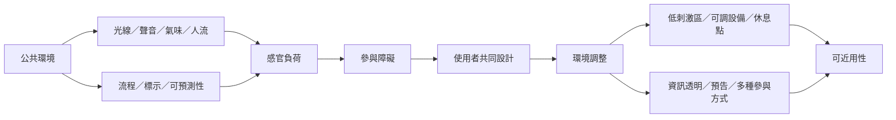

本圖整理從個體困擾到環境改善的路徑。感官友善不是單純降低所有刺激，而是提供可調整的刺激條件、清楚資訊、可預測流程與自主退出選項，讓不同人能參與公共生活。

閱讀路徑：從[[term/感官友善設計]]與[[term/通用設計]]開始，接著閱讀[[note/公共空間的感官條件會影響社會參與權]]、澳洲與瑞典交通研究，再閱讀[[idea/製作城市感官地圖能把個人不適轉化為公共設計資訊]]。

## 參考
* [[data/公共空間的感官障礙往往是多種環境線索交織而成]]
* [[data/英國NICE指引建議調整照明噪音顏色與個人空間以支持自閉症成人]]
* [[data/自閉症成人建議以間接照明與低刺激退避空間改善視覺環境]]
* [[data/澳洲研究顯示公共交通的擁擠與不確定性會加重自閉症青年的感官負擔]]
* [[data/瑞典公共交通訪談指出感官過載與不可預測性共同限制自閉者移動]]
* [[Sensory_overload]]。
