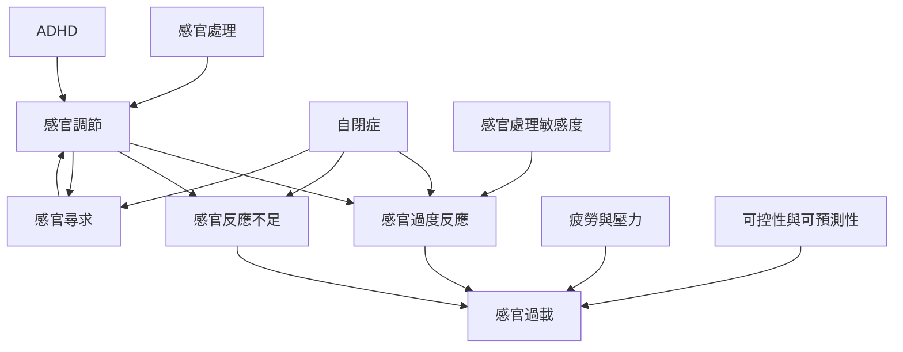

本圖整理感官輸入、反應型態、身體狀態與神經多樣性之間的關係。感官過載是一種情境經驗；不應由單一感官反應直接推論診斷。自閉症、ADHD 與感官處理敏感度的研究脈絡彼此有交集，但概念與證據不能互換。

閱讀路徑：先讀[[term/感官處理]]與[[term/感官調節]]，再比較三種感官反應，最後閱讀[[note/高敏感特質不能取代自閉症或ADHD等臨床脈絡]]。

## 參考
* [[data/共製研究顯示自閉症成人同時經驗感官過度反應不足與尋求]]
* [[data/統合分析發現ADHD族群在多種感官反應模式上平均較明顯但研究異質性很高]]
* [[data/最新理論回顧把感官處理敏感度連結到預測處理但指出概念仍待釐清]]
* [[Sensory_overload]]。
