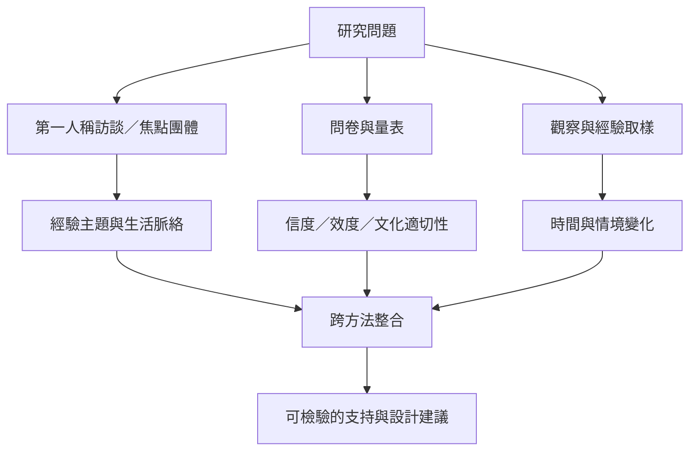

不同研究方法能回答不同問題。第一人稱訪談與參與式研究有助於理解經驗與生活脈絡；問卷與量表可比較反應模式，但需要檢驗信效度與文化適切性；系統性回顧可整合多項研究，卻仍受納入研究品質與異質性限制。

閱讀路徑：先閱讀第一人稱研究，再看台灣、南非與日本的量表與樣本研究，最後閱讀 ADHD 統合分析、SPS 理論回顧及治療證據。閱讀時始終分清楚質性經驗、相關性、測量品質與因果證據。

## 參考
* [[data/自閉症成人把感官過敏描述為刺激侵入身體且難以抽離]]
* [[data/台灣研究支持中文版感官知覺量表可用於評估自閉症成人感官敏感]]
* [[data/南非職能治療師指出感官評估工具需要符合當地語言與文化]]
* [[data/統合分析發現ADHD族群在多種感官反應模式上平均較明顯但研究異質性很高]]
* [[data/2025年隨機對照試驗回顧指出Ayres感官統合可支持部分自閉兒童的個人化功能目標]]
* [[Sensory_overload]]。
