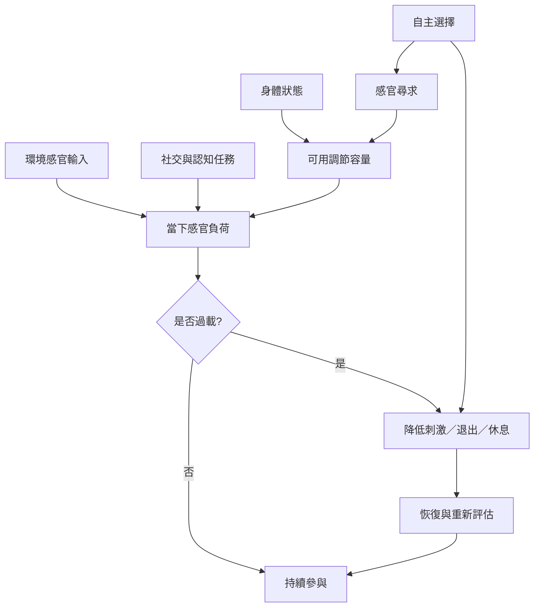

本圖把感官經驗放回身體與日常節奏中理解。刺激負荷會與疲勞、情緒、睡眠、疼痛和社交需求交互作用；調節方式可包含降低刺激、主動尋求合適輸入、獨處恢復與重新參與。

閱讀路徑：閱讀[[term/內感受]]、[[term/自我調節]]與[[term/異穩態負荷]]，再比較[[note/感官負荷會隨身體狀態動態變化]]與[[note/撤退休息可以是自主調節而不是失敗]]。

## 參考
* [[data/日常抽樣研究發現疲勞與不愉快的視聽刺激會提高高敏感者的過度刺激感]]
* [[data/自閉症倦怠訪談指出長期需求未獲回應會加劇感官困難與休息需求]]
* [[data/英國自閉症成人把獨處時間用於從社交與感官過載中恢復]]
* [[Sensory_overload]]。
