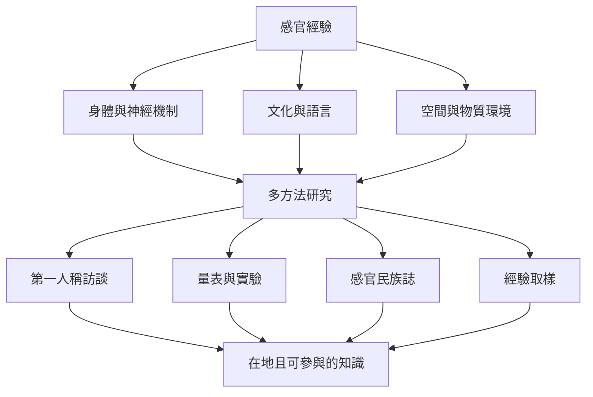

感覺經驗既是生理與心理現象，也是文化、語言、物質環境與權力關係的一部分。研究需把跨文化量表、第一人稱敘述、感官民族誌與日常經驗取樣放在互補位置。

概念連結：[[term/感覺民族誌]]、[[term/跨文化效度]]、[[term/經驗取樣法]]、[[term/感覺地景]]、[[term/感覺正義]]、[[term/感覺評估]]。

研究入口：[[data/多感官人類學指出感官經驗也受文化與社會秩序塑造]]、[[data/巴西幼兒感覺檔案量表需經文化調適才可使用]]、[[data/感官研究應同時關注全球在地知識與西方量表的適用界限]]。

延伸行動：[[idea/進行一週的感官微型民族誌記錄身體與環境互動]]、[[idea/設計跨文化感官詞彙比較避免把本地習慣當普遍標準]]。
