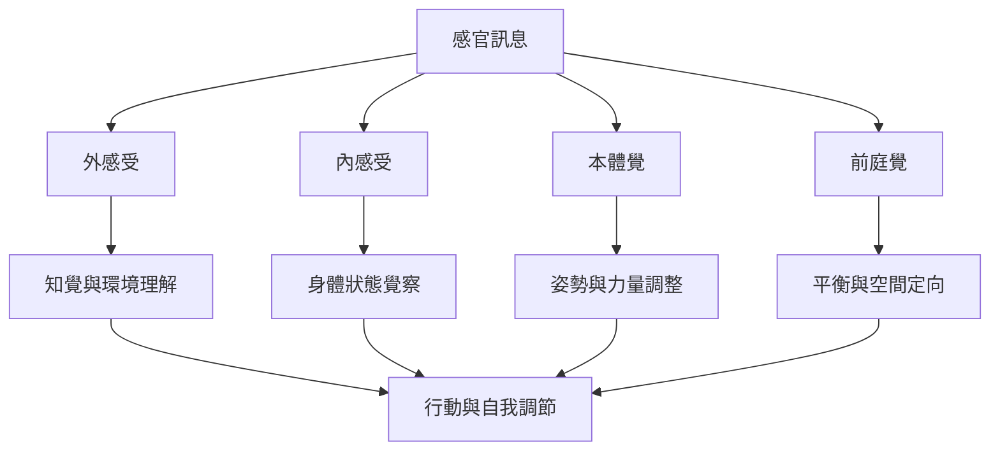

感官系統包含身體外部訊號與身體內部訊號。理解感覺經驗需要把內感受、本體覺、前庭覺與外感受分開描述，再觀察它們如何共同影響姿勢、情緒、注意與行動。

概念連結：[[term/外感受]]、[[term/內感受]]、[[term/本體覺]]、[[term/前庭覺]]、[[term/觸覺]]、[[term/身體覺察]]、[[term/身體掃描]]。

研究入口：[[data/自閉症內感受差異尚未呈現一致的群體模式]]、[[data/感知研究不能把跨感官錯覺效果直接等同整合能力]]。

延伸實踐：[[idea/從身體訊號提早察覺疲勞與壓力而非只處理外界刺激]]、[[idea/用赤腳步行與日常移動觀察觸覺本體覺和環境回饋]]。
