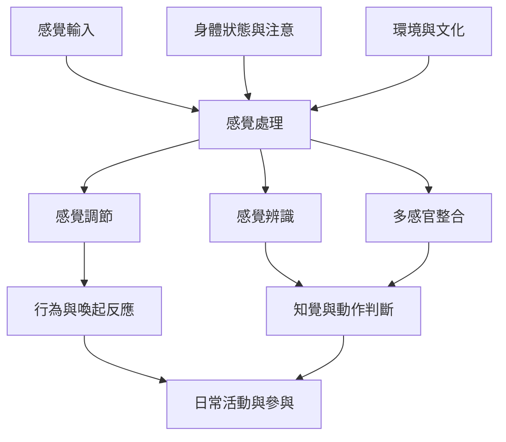

感覺處理是身體、神經系統與環境之間的動態互動。理解這個主題時，先區分感覺輸入、調節、辨識與整合，再用日常功能與情境資料觀察個體差異。核心理論可由 [[term/感覺處理]]、[[term/Dunn四象限模型]]、[[term/感覺閾值]] 與 [[term/Ayres感覺統合]] 進入。

概念脈絡：[[term/外感受]]、[[term/內感受]]、[[term/本體覺]]、[[term/前庭覺]]、[[term/感覺過度反應]]、[[term/感覺反應不足]]、[[term/感覺尋求]]。

核心整理：[[note/感覺處理是身體與環境共同生成的動態經驗]]、[[note/感覺差異不能簡化成單一的敏感度高低]]、[[note/感覺調節與感覺辨識是不同層次的能力]]、[[note/感覺系統不只五感還包括內感受本體覺與前庭覺]]。

證據起點：[[data/Dunn模型以神經閾值與行為反應組織感覺模式]]、[[data/感知研究不能把跨感官錯覺效果直接等同整合能力]]。

延伸問題：[[idea/建立個人感官地圖以辨識可調節因素]]、[[idea/用感官日誌把刺激情境身體反應與需求連成可行動資料]]。
