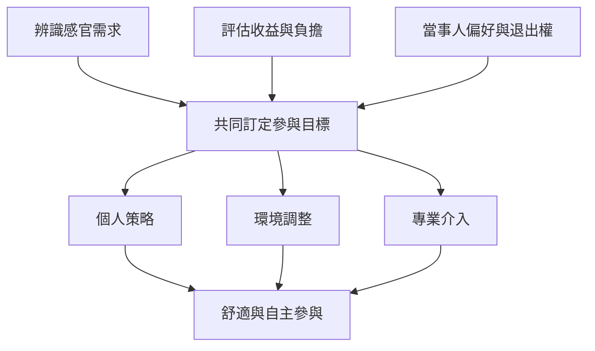

感官支持的目標不是把所有人調整成同一種感官反應，而是讓個體能以較少不必要的負擔參與有意義的活動。策略可從個人覺察、環境改造、合理調整、共同決策與循證介入多個層次展開。

概念連結：[[term/感覺友善設計]]、[[term/通用設計]]、[[term/合理調整]]、[[term/共同決策]]、[[term/職能參與]]、[[term/感覺正義]]。

研究入口：[[data/自閉症友善建築需提供安全可調整可預測與可恢復的環境]]、[[data/感覺統合介入的證據取決於具體方案與功能目標]]、[[data/2026系統性回顧支持Ayres感覺統合介入改善個別目標]]、[[data/失智症多感官刺激研究仍欠缺一致方案與長期追蹤]]。

可行行動：[[idea/把感官友善空間設計成可選擇而非單一標準]]、[[idea/為公共活動加入退出與恢復設計以降低感官參與門檻]]、[[idea/以參與為目標共同訂定感官介入實驗]]。
