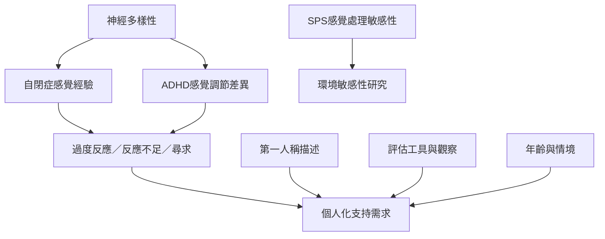

自閉症與 ADHD 研究顯示感覺反應差異具有重要生活影響，但群體平均不能替代個人經驗。高敏感特質（SPS）、感覺處理困難與神經發展診斷之間可能有重疊，卻不是同義詞。第一人稱資料應與量表及觀察並列。

概念連結：[[term/神經多樣性]]、[[term/感覺處理敏感性]]、[[term/感覺過度反應]]、[[term/感覺反應不足]]、[[term/感覺尋求]]、[[term/內感受]]。

研究入口：[[data/自閉症成人描述的感覺經驗同時包含過度反應不足反應與尋求]]、[[data/ADHD與感覺調節差異呈現廣泛關聯但研究異質性高]]、[[data/自閉症內感受差異尚未呈現一致的群體模式]]、[[data/中高齡自閉症者仍可能經歷持續或加劇的感覺困難]]、[[data/高敏感特質研究提出預測處理解釋但與診斷類別不同]]。

核心主張：[[note/第一人稱描述是感覺經驗研究不可替代的資料]]、[[note/SPS高度敏感人群不等同於自閉症或感覺處理障礙]]、[[note/感覺處理差異跨越生命歷程並受情境與健康狀態影響]]。
