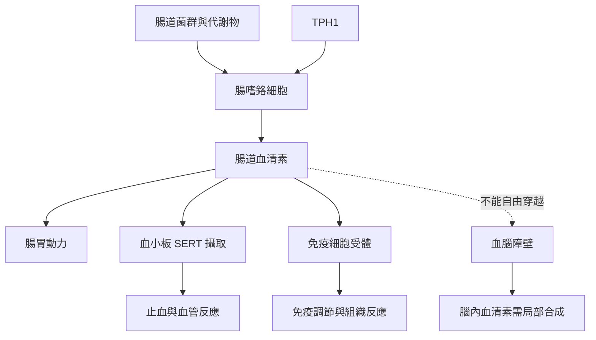

此圖聚焦腸道與周邊血清素。腸嗜鉻細胞、腸道菌代謝物、血小板、血管及免疫細胞形成互相連結的系統；周邊血清素與腦內血清素之間仍受血腦障壁限制。

## 雙向連結
* [[腸道菌群]]、[[腸嗜鉻細胞]]、[[TPH1]]、[[周邊血清素]]、[[血小板]]、[[血清素轉運蛋白]]、[[腸腦軸]]、[[血腦障壁]]、[[類癌症候群]]。
* [[腸道菌群能調節腸嗜鉻細胞的血清素合成]]、[[血清素的周邊功能包含血小板與血管調節]]、[[周邊血清素會依細胞與受體脈絡調節免疫反應]]。

## 參考
* [[Serotonin]]。
