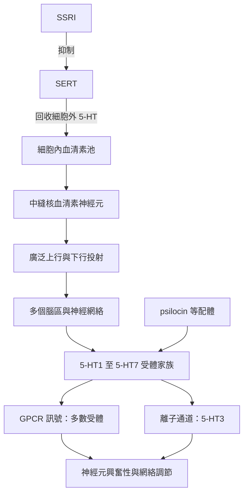

此圖將血清素神經元、中縫核投射、受體家族與細胞訊號放在一起。它不是單一「情緒通路」，而是由多個亞型與迴路組成的調節網絡。

## 雙向連結
* [[血清素]]、[[血清素受體]]、[[5-HT1A受體]]、[[5-HT2A受體]]、[[5-HT3受體]]、[[血清素轉運蛋白]]、[[中縫核]]、[[神經調節]]、[[選擇性血清素再吸收抑制劑]]、[[迷幻藥]]。
* [[血清素受體分成七大類且訊號效果並不相同]]、[[中縫核神經元透過廣泛投射調節多個腦區]]、[[血清素轉運蛋白改變訊號清除而非直接量測情緒]]。

## 參考
* [[Serotonin]]。
