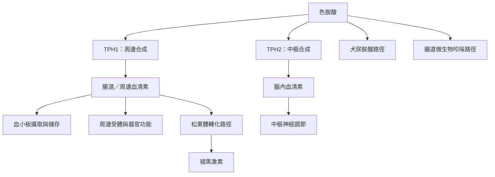

這張圖整理色胺酸如何進入中樞與周邊血清素合成，並連到褪黑激素、犬尿胺酸與吲哚代謝。關鍵是分辨不同組織中的酵素與代謝分流。

## 雙向連結
* [[色胺酸]]、[[TPH1]]、[[TPH2]]、[[血清素]]、[[5-HIAA]]、[[褪黑激素]]、[[犬尿胺酸路徑]]、[[吲哚代謝物]]、[[腦內血清素]]、[[周邊血清素]]。
* [[色胺酸經由TPH1與TPH2形成周邊及中樞血清素]]、[[色胺酸會分流進入血清素犬尿胺酸與吲哚路徑]]、[[松果體以血清素作為褪黑激素合成的前驅物]]。

## 參考
* [[Serotonin]]。
