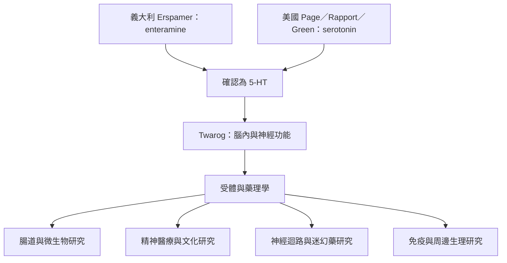

血清素研究由義大利對 enteramine 的研究、美國對血清 vasoconstrictor 的分離、哺乳動物腦內定位及後續受體藥理學逐步形成。其後，跨國研究者在腸道微生物、免疫、神經迴路、精神藥物文化與迷幻藥研究等方向擴展此領域。

## 雙向連結
* [[血清素]]、[[Serotonin]]、[[血清素的發現源自義大利與美國兩條研究路線]]、[[Betty Twarog的研究使血清素進入神經科學視野]]、[[精神藥物的意義由分子作用與社會制度共同塑造]]。
* [[血清素研究史提醒我們分子發現與功能解釋是不同工作]]、[[比較義大利與美國的血清素發現史並補上被忽略的人物]]。

## 參考
* [[Serotonin]]。
