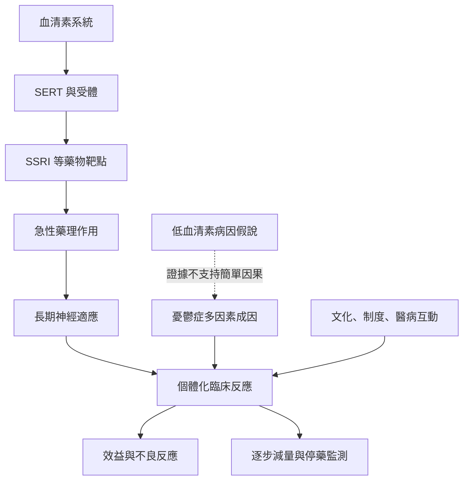

此圖區分血清素生物學、憂鬱症病因假說、藥物靶點、臨床反應與停藥風險。藥物能改變訊號不代表單一化學失衡假說成立。

## 雙向連結
* [[憂鬱症]]、[[選擇性血清素再吸收抑制劑]]、[[血清素轉運蛋白]]、[[血清素症候群]]、[[生物心理社會模式]]、[[血清素]]。
* [[血清素不足並非憂鬱症成因的已確立證據]]、[[抗憂鬱藥療效研究不能單獨證明血清素假說]]、[[抗憂鬱藥減量需要考慮停藥反應與個別差異]]、[[化學失衡敘事可能把複雜痛苦過度簡化]]。

## 參考
* [[Serotonin]]。
