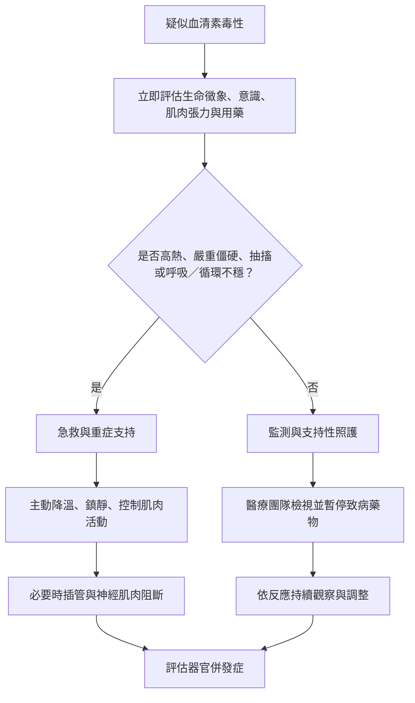

臨床處置依嚴重度遞增，而不是一開始就假設每位患者需要相同藥物。輕症需由醫療團隊檢視相關藥物與症狀；中重症需監測、支持性照護及專業毒理意見；嚴重高熱、僵硬、癲癇或意識改變則應立即進入急救與重症照護。

關聯概念：[[note/治療優先次序應由嚴重度決定而不是追逐特效解毒劑]]、[[note/嚴重高熱與肌肉僵硬是器官損傷的危險路徑]]、[[note/賽庚啶的臨床證據有限且不能取代支持性照護]]、[[data/台灣消防署公布119與112緊急救難專線資訊]]。

全書導讀：[[Serotonin_syndrome]]