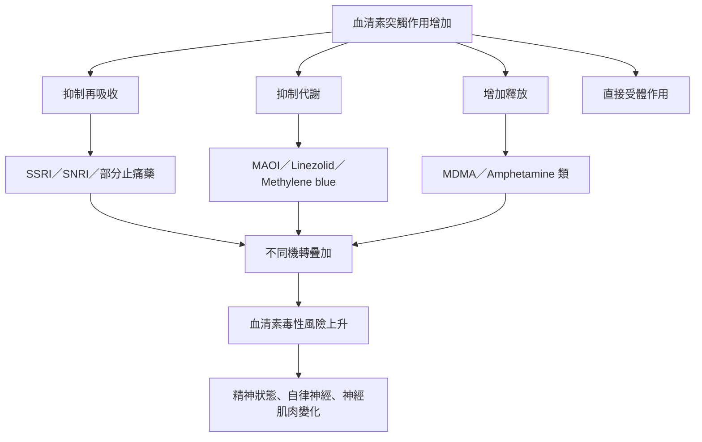

血清素毒性可由多條藥理路徑造成：增加血清素合成或釋放、抑制代謝、抑制再吸收，或直接影響受體作用。多種機轉疊加（尤其 MAOI 與再吸收抑制藥）可能提高毒性風險。藥物名單應結合機轉、暴露情境與證據強度判讀。

關聯概念：[[note/單胺氧化酶抑制劑與再吸收抑制劑的組合具有較高風險]]、[[note/藥物清單必須依機轉與證據分層解讀]]、[[note/用藥變動與症狀起始的時間關係是重要診斷線索]]、[[term/血清素轉運蛋白]]、[[term/單胺氧化酶抑制劑]]。

全書導讀：[[Serotonin_syndrome]]