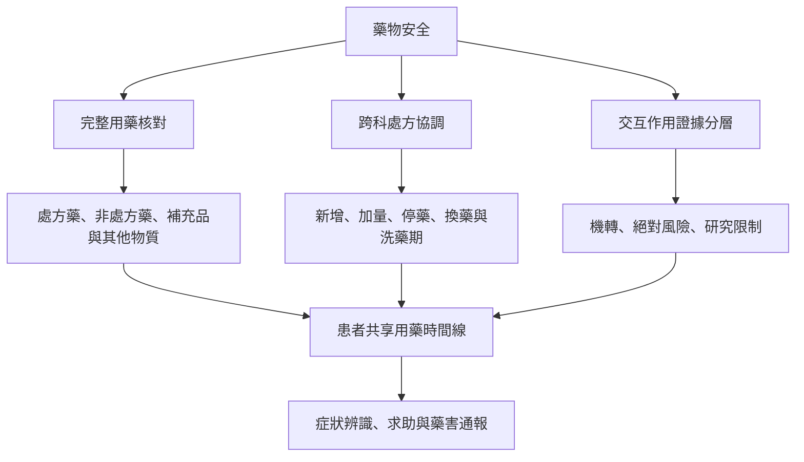

降低風險需要處方者、藥師、患者與醫療系統共同協作。重點包括完整用藥核對、跨科交接、藥物轉換時間線、風險分層警示、患者容易理解的求助資訊，以及疑似不良反應的系統性通報。

關聯概念：[[note/藥物轉換與洗藥期是可預防的風險節點]]、[[note/藥物警示必須同時呈現絕對風險與證據強度]]、[[idea/建立簡明的血清素毒性用藥與症狀紀錄卡]]、[[idea/建立跨科別一致的完整用藥盤點流程]]。

全書導讀：[[Serotonin_syndrome]]