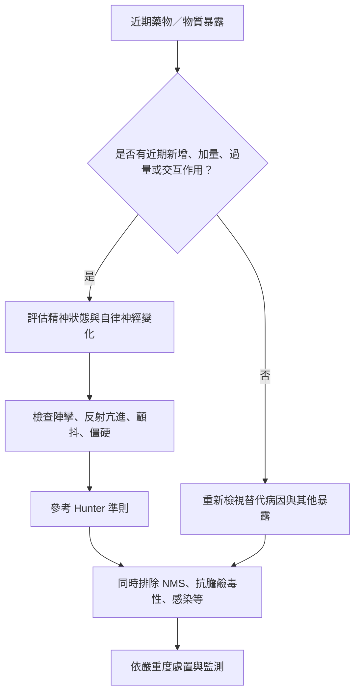

診斷不是尋找單一檢驗值，而是整合近期藥物暴露、症狀時間線、神經肌肉徵象與其他病因。Hunter 準則提供臨床決策架構，但外推至穩定劑量或非典型病例時須保留限制。

關聯概念：[[note/血清素毒性的診斷必須同時考慮暴露史與替代病因]]、[[note/Hunter準則的高敏感度不能消除其外推限制]]、[[note/陣攣與反射亢進是辨識血清素毒性的關鍵神經肌肉線索]]、[[note/鑑別診斷應以暴露史和神經肌肉檢查互相校正]]。

全書導讀：[[Serotonin_syndrome]]