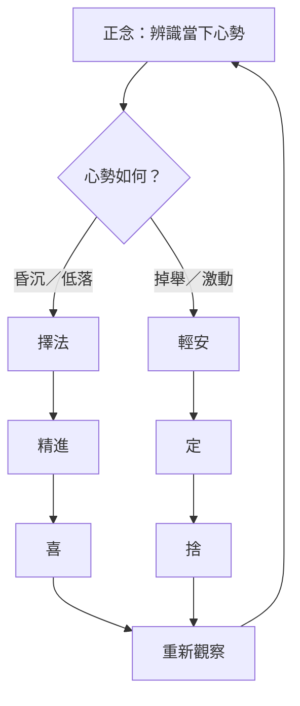

七覺支並非七項都要同時加強。依 SN 46.53，心昏沉時宜強化擇法、精進、喜；心掉舉時宜培養輕安、定、捨；念則在兩種情況下都需要。此圖呈現「先辨識，再調節，再回看」的循環。

## 關係圖

## 雙向連結
[[七覺支以活化因子與安定因子的平衡回應不同心勢]]、[[正念覺支是辨識其他覺支是否合時的樞紐]]、[[昏沉時先增加清晰度與探索而不是責備自己不夠精進]]、[[掉舉時減少刺激並培育輕安定與捨]]。

核心概念：[[念覺支（sati-sambojjhaṅga）]]、[[擇法覺支（dhamma-vicaya-sambojjhaṅga）]]、[[精進覺支（viriya-sambojjhaṅga）]]、[[喜覺支（pīti-sambojjhaṅga）]]、[[輕安覺支（passaddhi-sambojjhaṅga）]]、[[定覺支（samādhi-sambojjhaṅga）]]、[[捨覺支（upekkhā-sambojjhaṅga）]]。

專題導讀：[[Seven_Factors_of_Awakening]]
