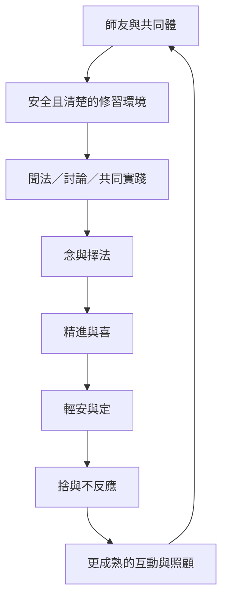

七覺支首先描述修行者的心智品質，但經典也指出善知識、聞法、憶念與生活條件會支持其生長。現代實踐可把這一點延伸到共修空間、團體閱讀、共同進食與對話倫理：環境本身不會替人覺悟，卻能降低障礙、支持善巧行為。

## 關係圖

## 雙向連結
[[善知識與共修環境是覺支培育的互依條件]]、[[共修團體可以共同創造滋養七覺支的環境]]、[[在團體對話中用正念與捨減少自動防衛]]、[[培養不依賴消費與刺激的喜覺支]]。

核心概念：[[平等心]]、[[正念]]、[[四無量心]]、[[七覺支（satta bojjhaṅgā）]]。

專題導讀：[[Seven_Factors_of_Awakening]]
