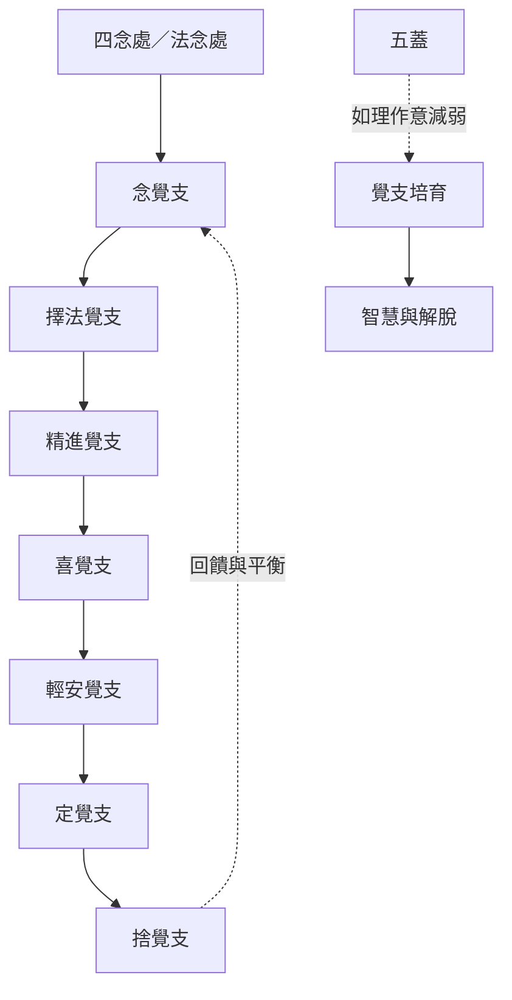

七覺支是一組互相支持、能依條件培育的覺悟因素。念負責知道當下狀態，擇法與精進帶來清楚的辨識和活力，喜支持投入，輕安使身心柔軟，定讓心穩定，捨則使觀察不被苦樂牽引。

這張地圖把七覺支放在三個座標中：一是四念處的觀察架構，二是五蓋與覺支的對治關係，三是依昏沉／掉舉進行調節的動態平衡。

## 關係圖

## 雙向連結
[[七覺支不是七個待完成步驟而是彼此滋養的修行系統]]、[[七覺支以如理作意和生活條件培養而不是靠意志命令]]、[[七覺支在四念處的法念處中被觀察並培育]]、[[五蓋與七覺支提供一張辨識心智障礙和支持條件的雙面地圖]]、[[七覺支適合作為狀態辨識工具而不是自我評分表]]。

核心概念：[[七覺支（satta bojjhaṅgā）]]、[[四念處]]、[[五蓋]]、[[三十七菩提分法]]。

專題導讀：[[Seven_Factors_of_Awakening]]
