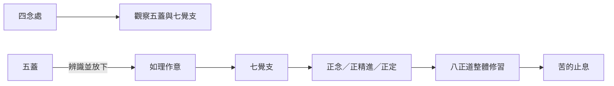

七覺支在修道地圖中不是孤立單元：四念處提供觀察身、受、心、法的架構；五蓋提醒哪些心態可能遮蔽智慧；七覺支說明哪些品質能被培養；八正道則將正見、倫理、精進、正念與正定整合為完整道路。

## 關係圖

## 雙向連結
[[七覺支在四念處的法念處中被觀察並培育]]、[[五蓋與七覺支提供一張辨識心智障礙和支持條件的雙面地圖]]、[[七覺支與八正道互相支持而不構成互斥的修行法門]]、[[七覺支的次第是教學線索而非每次禪修都相同的時間表]]。

核心概念：[[四念處]]、[[五蓋]]、[[八正道]]、[[四正勤]]、[[三十七菩提分法]]。

專題導讀：[[Seven_Factors_of_Awakening]]
