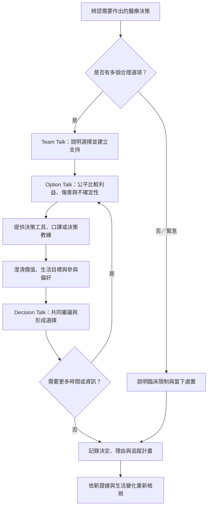

共享決策不是單一問句或一張表單，而是一段可以跨越多次會談、並依個人需要反覆往返的決策歷程。核心順序是先確認存在何種決策與選項，再提供可理解的證據與風險資訊，接著辨認價值、支持需求與參與方式，最後形成暫時或正式決定並安排追蹤。

這張地圖連結[[共享決策]]、[[三段式對話模型]]、[[決策教練]]、[[價值澄清]]、[[風險溝通]]與[[決策衝突]]。其實踐需符合[[共享決策只適用於存在合理選項且價值會影響選擇的決策]]，並避免把流程簡化為[[知情同意]]。

## 延伸閱讀
* [[每次重要門診都可以用三段式對話卡片檢查是否真正共享決策]]
* [[為重大醫療選擇安排第二次會談能減少倉促決定的壓力]]
* [[把病人的生活目標寫進決策摘要能讓醫療選項更貼近真實生活]]
