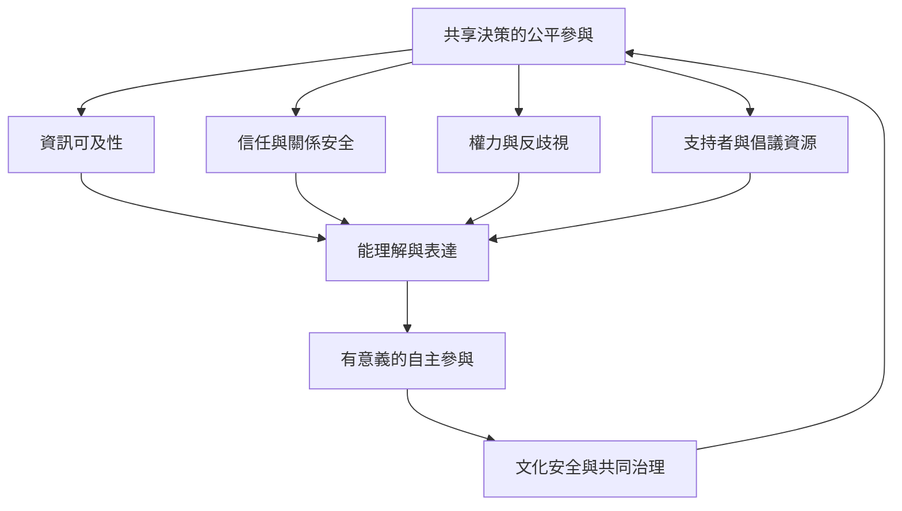

人人都能在形式上被邀請參與，不代表人人都擁有相同的參與條件。語言、健康識能、障礙、家庭關係、種族歧視、醫療權力與制度資源都會改變一個人能否理解資訊、提出異議或拒絕治療。公平的共享決策必須提供支持性決策、口譯、倡議與文化安全，並檢查病人是否真的能安全表達。

本地圖連結[[支持性決策]]、[[健康識能]]、[[文化安全]]、[[照護倫理]]、[[共同生產]]與[[醫療家長主義]]。全球經驗包括[[毛利病人的共享決策經驗顯示文化安全與關係信任不可分割]]、[[原住民族醫療經驗揭示語言障礙與權力失衡會破壞決策信任]]及[[精神醫療的共享決策需要支持自主也需要處理強制與風險管理]]。

## 延伸閱讀
* [[把口譯與倡議支持列為共享決策的必要資源而非特殊福利]]
* [[把文化安全與權力影響納入共享決策品質稽核]]
* [[把共享決策視為互賴照護而不是個人主義式的自主競賽]]
