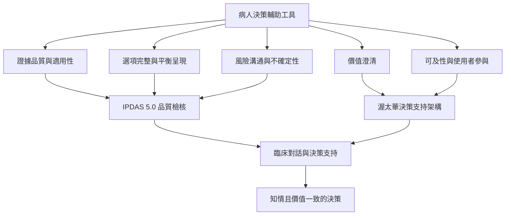

決策輔助工具的品質取決於證據是否適用、選項是否完整平衡、風險是否可比較、價值是否能被澄清，以及使用者是否參與設計。IPDAS 5.0 提供工具品質底線，渥太華架構則補足如何依個別決策需求提供支持。工具不是答案，而是將證據帶進對話的中介。

本地圖連結[[病人決策輔助工具]]、[[IPDAS]]、[[渥太華決策支持架構]]、[[實證醫學]]、[[風險溝通]]、[[健康識能]]與[[價值澄清]]。

## 延伸閱讀
* [[設計決策工具前應先訪談真正要使用它的病人]]
* [[醫療決策工具應公開資金來源、證據日期與更新責任]]
* [[數位與 AI 決策工具必須呈現不確定性並保留人的審議空間]]
