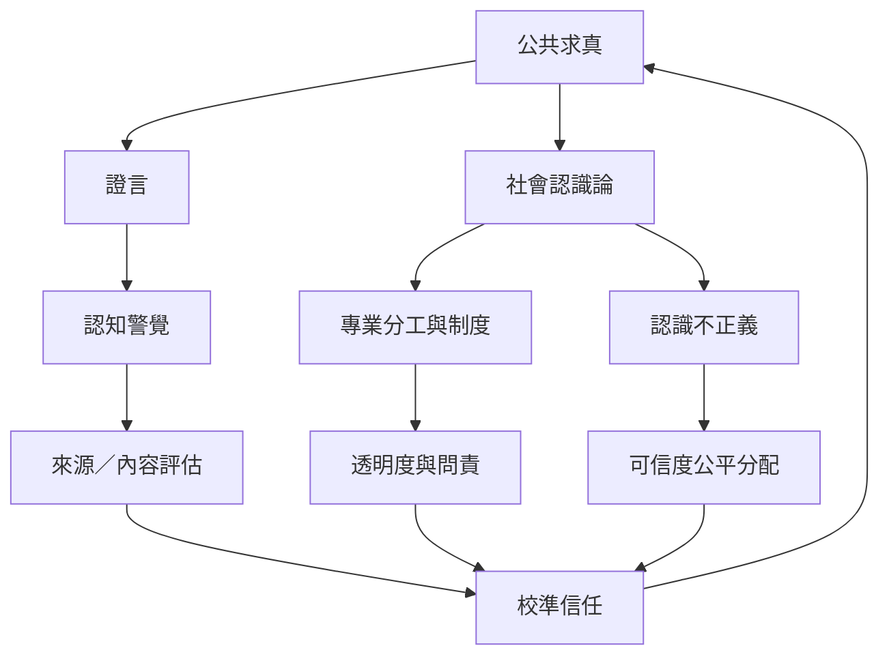

公共知識不是孤立個人獨力完成，而是依賴證言、專業分工、社群記憶與制度。合理的懷疑必須同時避免輕信與無差別不信任，也要檢查可信度分配是否受到偏見或權力影響。

## 思與行
* 對不同來源採用可說明的一致標準，並對弱勢或被忽略的知識者保持反身性。
* 在社群中建立共同查核、公開更正與不羞辱的討論規範。

## 參考
* [[data/證言是不可或缺但需要情境化判斷的知識來源]]、[[data/認知警覺讓人類在依賴他人傳訊時辨識誤導風險]]。
* [[data/認識不正義提醒人們可信度判斷也可能複製權力]]、[[data/社會認識論研究我們如何透過他人與制度共同求真]]。
