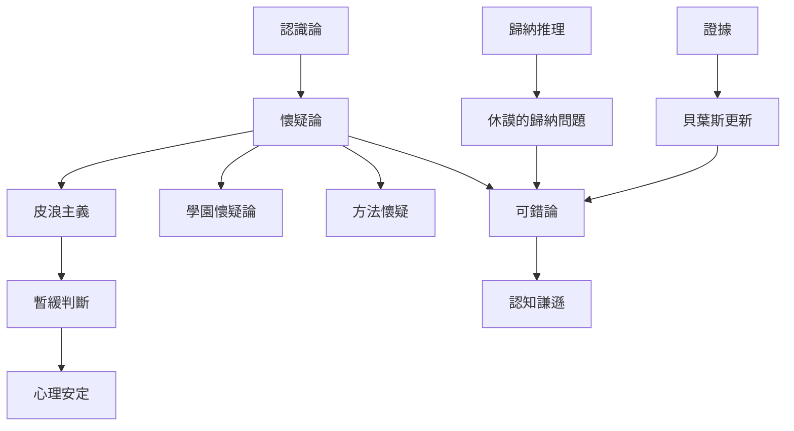

本圖整理懷疑論的哲學問題：我們如何知道、理由如何支持信念，以及在證據不足時如何暫緩判斷。它把古代懷疑、方法懷疑、歸納問題與可錯論放在同一張地圖中，但不把不同傳統視為同一學說。

## 思與行
* 閱讀路徑：先看 [[term/認識論]]，再看 [[term/懷疑論]]、[[term/皮浪主義]] 與 [[term/暫緩判斷]]，最後進入 [[term/可錯論]] 和 [[term/歸納推理]]。
* 把每個懷疑論論證標註為「挑戰知識來源」、「挑戰推理方式」或「挑戰知識整體」，避免混淆。

## 參考
* [[data/古希臘懷疑論把哲學家理解為持續探究的人]]、[[data/哲學懷疑論區分皮浪式休止判斷與笛卡兒式方法懷疑]]、[[data/休謨的歸納問題揭示過去經驗無法演繹保證未來]]。
* [[note/暫緩判斷能在證據不足時保留思考空間]]、[[note/歸納推理讓知識可用但也使預測保持可修正]]。
