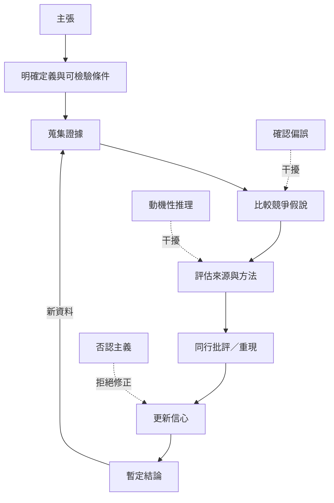

科學懷疑不是對所有主張保持同樣程度的不信，而是透過反證條件、研究透明度、可重現性、證據比較與持續更新建立合理信心。否認主義則會借用懷疑語言，卻拒絕對稱標準與可能的修正。

## 思與行
* 用一個真實議題實作流程，記錄支持與反對證據的品質，不只統計數量。
* 當結論改變時保留修訂紀錄，讓改變成為知識進步的證據。

## 參考
* [[data/波普爾的可證偽性要求科學主張承擔被反駁的風險]]、[[data/科學的可重現性是公開校正而不是要求每次結果完全一致]]。
* [[data/否認主義會策略性製造懷疑而不是開放檢驗]]、[[data/證據確認理論說明資料如何調整假說的可信程度]]。
