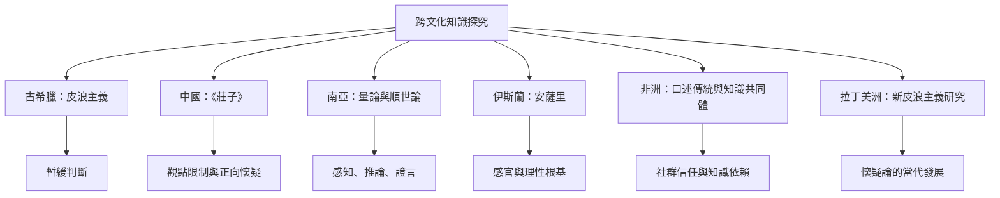

這張地圖把希臘、中國、南亞、伊斯蘭世界、非洲與拉丁美洲的懷疑或知識批判並置。比較不代表它們完全等同：它們各自處理的知識來源、宗教脈絡、社會制度與生活目標可能不同。

## 思與行
* 以「知識來源、懷疑對象、實踐目的、社會脈絡」四個欄位比較各傳統。
* 不要將其他文化思想只當成西方哲學概念的例證；盡可能回到原典及當地研究者的解釋。

## 參考
* [[data/莊子的懷疑提醒判斷標準與觀點都可能受限]]、[[data/印度古典知識論以知識來源檢驗信念的正當性]]、[[data/安薩里以懷疑感官與推理檢查確定知識的根基]]。
* [[data/非洲口述傳統顯示知識依賴可以是合理的集體實踐]]、[[data/拉丁美洲哲學家把懷疑論發展為持續的當代研究傳統]]。
