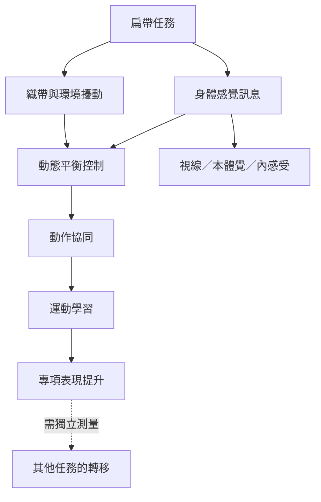

扁帶平衡涉及身體、感覺系統、織帶反饋與環境條件的動態耦合。隨練習進行，參與者可能形成更協調的跨關節動作，但專項成效不必然遷移到日常平衡或其他任務。

本地延伸閱讀：[[扁帶上的平衡是人與器材耦合的動態控制]]、[[技能習得會重組跨關節協同而不只是增加肌力]]、[[平衡能力具有任務特異性訓練成效不會自動轉移]]、[[動態平衡]]、[[感覺動作整合]]、[[動作協同]]、[[運動學習]]、[[data/初學者在扁帶練習中逐步形成跨關節協同模式]]。
