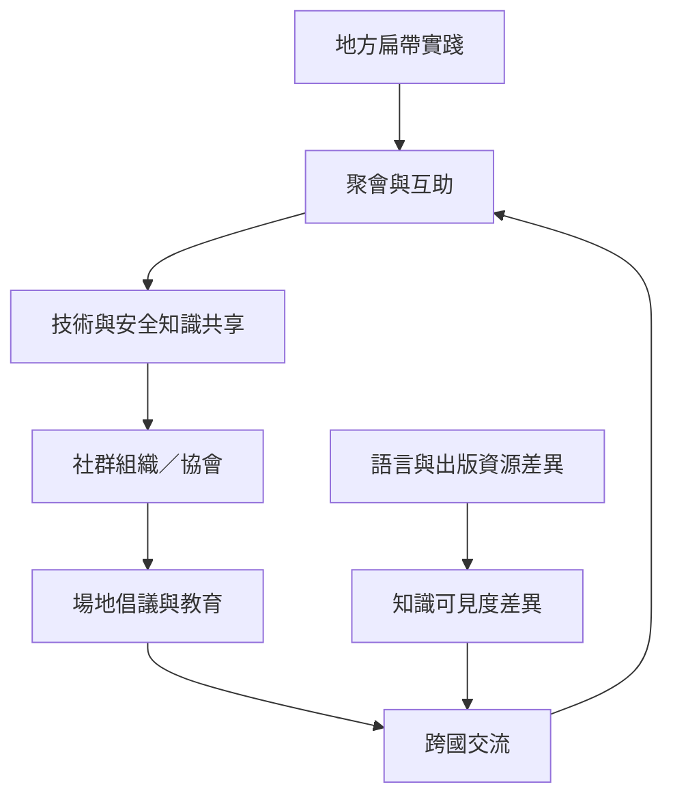

扁帶文化從攀岩場景擴展到公園、競技、節慶與高空線聚會。不同地區的組織化程度、場地制度與語言資源不一；社群聚會和跨國互助是知識傳遞的重要管道。

本地延伸閱讀：[[Slackline 社群以共享知識維持跨國運動網絡]]、[[扁帶活動的樂趣同時來自個人挑戰與共同參與]]、[[高空扁帶聚會透過共同架設生產暫時性的社會空間]]、[[全球扁帶知識的可見度受到語言與研究資源不均影響]]。

地區資料入口：[[data/現代 Slacklining 起源於優勝美地攀岩者的休息日平衡遊戲]]、[[data/國際扁帶協會由跨國草根社群合作建立]]、[[data/法國社會學研究將同伴互助列為扁帶持續參與的重要動機]]、[[data/義大利城市民族誌指出扁帶運動重組人與自然的想像]]、[[data/拉丁美洲高空扁帶民族誌連結身體情緒與空間生產]]、[[data/南非扁帶社群以訪談節慶與跨國交流發展在地網絡]]、[[data/印度扁帶社群透過大型聚會推動高空線教育與場地可及性]]、[[data/日本已有全國性扁帶組織並納入運動團體治理資料]]、[[data/澳洲扁帶協會將安全教育治理與場地倡議整合成資源庫]]。
