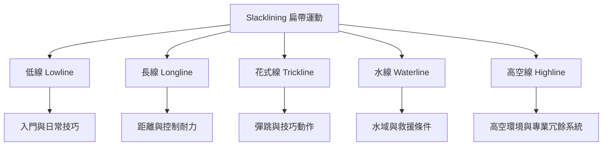

Slacklining 是一個涵蓋多種場景與任務的運動家族。分類時應同時考慮高度、長度、織帶動態、動作目標與落地／救援條件；不要把不同流派視為同一種器材或風險。

本地延伸閱讀：[[扁帶（Slackline）]]、[[低線]]、[[長線]]、[[花式線]]、[[水線]]、[[高空線]]、[[不同流派與器材形態不能被視為同一種介入]]、[[data/How to Slackline 提供低線長線花式線與高空線的技術導讀]]、[[note/歐洲扁帶實務書籍把技巧教學與環境及安全責任放在同一脈絡]]。
