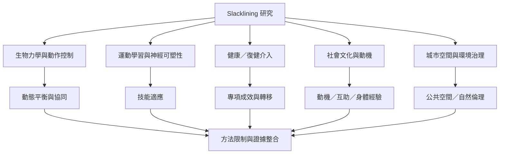

Slacklining 的研究跨越生物力學、運動學習、老年運動、神經影像、社會學與城市研究。不同研究回答不同問題：動作協同不等於臨床效益，腦活動不等於主觀專注，質性訪談也不適合推估人口比例。

本地延伸閱讀：[[動作表現神經指標與主觀經驗需要分開描述]]、[[復健應用必須區分初步可行性與臨床療效]]、[[風險統計需要透明呈現分母估計與漏報限制]]、[[循證實踐]]、[[研究設計]]、[[測量效度]]。
