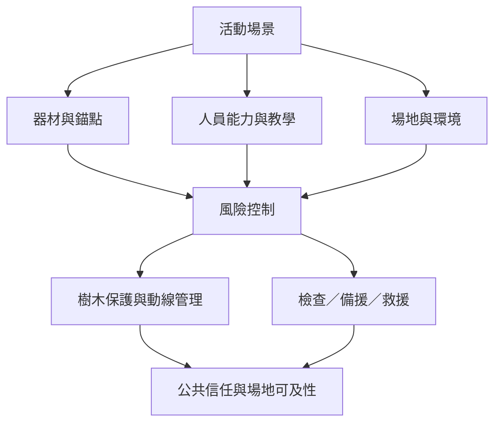

扁帶安全是一個系統問題：器材、錨點、練習者、場地、其他使用者與環境彼此關聯。低線新手活動、高空線及花式線的風險結構不同；場地許可、樹木保護與共同檢查不可被技巧熟練取代。

本地延伸閱讀：[[高空扁帶將個人技術建立在冗餘系統與共同檢查上]]、[[安全文化必須由社群共同維護而不能只靠個人判斷]]、[[樹木保護是戶外扁帶社群公共信任的基礎]]、[[安全設計]]、[[風險治理]]、[[冗餘設計]]、[[公共空間]]、[[環境倫理]]、[[data/國際扁帶協會提出高空線冗餘系統與雙重檢查原則]]。
