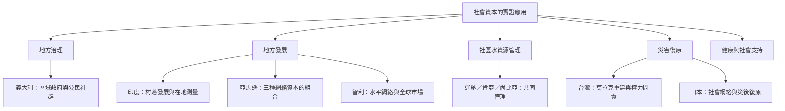

全球實證研究顯示，社會資本必須置於地方歷史、制度與資源條件下理解。歐洲的義大利區域研究連結公民參與與治理；南亞印度村落研究凸顯在地測量與能動性；非洲社區水管理研究說明合作網絡如何支持公共設施；南美亞馬遜與智利案例呈現地方自主與垂直資源連結的張力；台灣莫拉克重建與日本災害研究則揭示連結權力、鄰里關係及復原韌性。

**雙向連結：** [[集體行動]]、[[制度能力]]、[[社會韌性]]、[[社會支持]]、[[共同治理]]、[[連結型社會資本]]。

**延伸閱讀：** [[義大利區域研究將公民參與與地方治理表現連結起來]]、[[印度六十九個村落研究顯示社會資本測量必須貼近地方脈絡]]、[[迦納肯亞與尚比亞的社區水系統仰賴合作網絡與地方能動性]]、[[亞馬遜河流社群領袖必須組合三種社會資本才能連結外部資源]]、[[台灣莫拉克風災重建顯示連結型社會資本可能形成菁英支配]]、[[日本關東大地震後的東京研究指出社會網絡是災後復原的重要基礎]]。
