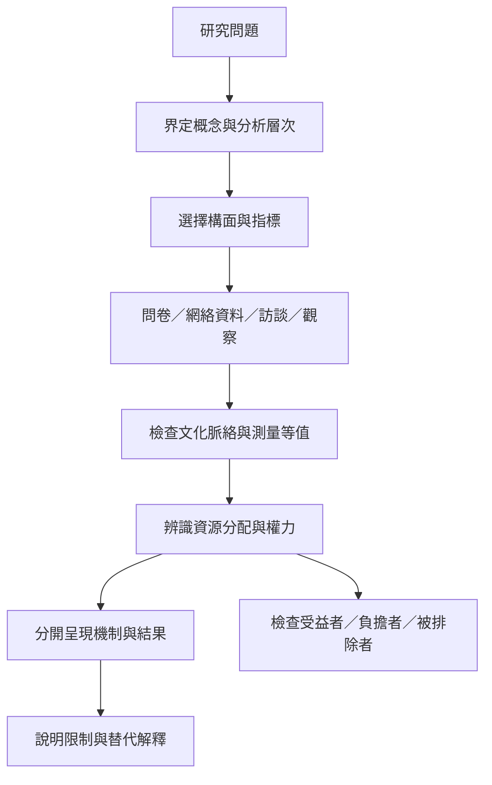

社會資本研究最重要的方法工作，是避免把概念當成萬用解釋。必須先說清楚研究的是關係、資源、支持、參與、信任還是合作規範，再區分分析層次與結果變項。正面效益不代表沒有排除成本；網絡密集不代表資源平等；跨國指標也未必具有文化等值性。

**雙向連結：** [[社會資本測量]]、[[社會排除]]、[[社會不平等]]、[[信任]]、[[社會支持]]、[[公民參與]]、[[制度能力]]。

**延伸閱讀：** [[社會資本測量需要區分關係支持參與與信任]]、[[跨文化比較不能假設社團參與具有相同意義]]、[[社會資本的正面效益必須與排除成本一起分析]]、[[社會資本與健康的關聯不能直接解讀為因果效果]]、[[數位連結可以擴展網絡卻不保證平等參與]]。
