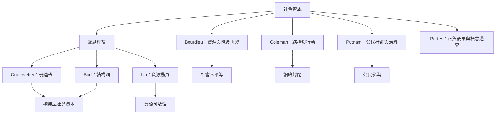

這張概念地圖比較社會資本的主要理論傳統：布迪厄著重關係網絡中的資源與階級再製；科爾曼關注社會結構如何促成行動；Putnam 強調公民社群、信任與治理；Granovetter、Burt 與 Lin 則提供網絡結構、弱連帶、結構洞與資源動員的分析工具。Portes 的批判提醒，社會資本的好處必須與負面後果一起理解。

**雙向連結：** [[社會資本]]、[[社會資本是關係網絡中可被動員的資源]]、[[社會資本理論的差異來自資源位置網絡結構與受益層次]]、[[社會資本的累積可能再製既有階級優勢]]、[[網絡封閉同時具有協調與控制效果]]。

**延伸閱讀：** [[社會資本的概念必須放回階級與資本轉換關係中理解]]、[[科爾曼指出社會結構能透過義務資訊與規範促成行動]]、[[義大利區域研究將公民參與與地方治理表現連結起來]]、[[弱連帶能讓資訊跨越緊密群體的邊界]]、[[林南將社會資本界定為可從網絡取得並動員的資源]]、[[波特斯整理社會資本的來源與負面後果]]。
