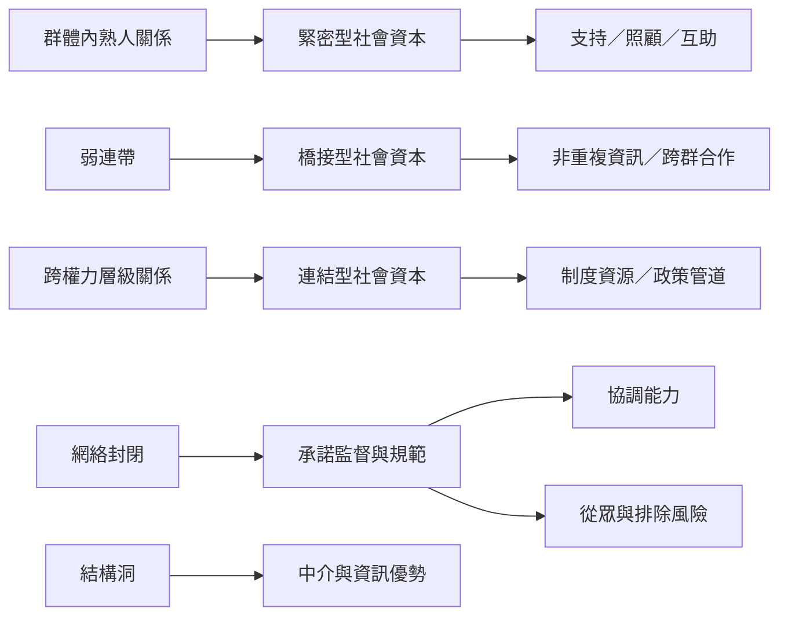

社會資本不是單一網絡形式，而是多種關係結構中的資源流動。緊密型網絡支持內部互助；橋接型網絡連接不同群體；連結型網絡跨越權力層級。弱連帶與結構洞說明新資訊如何跨越網絡區塊；網絡封閉則說明信任、承諾與社會控制如何生成。

**雙向連結：** [[社會網絡]]、[[緊密型社會資本]]、[[橋接型社會資本]]、[[連結型社會資本]]、[[弱連帶]]、[[結構洞]]、[[網絡封閉]]、[[互惠規範]]。

**延伸閱讀：** [[三種社會資本需要互相組合才能處理跨層次問題]]、[[弱連帶讓不同群體之間出現資訊橋梁]]、[[網絡封閉同時具有協調與控制效果]]、[[連結型社會資本應接受權力問責]]。
