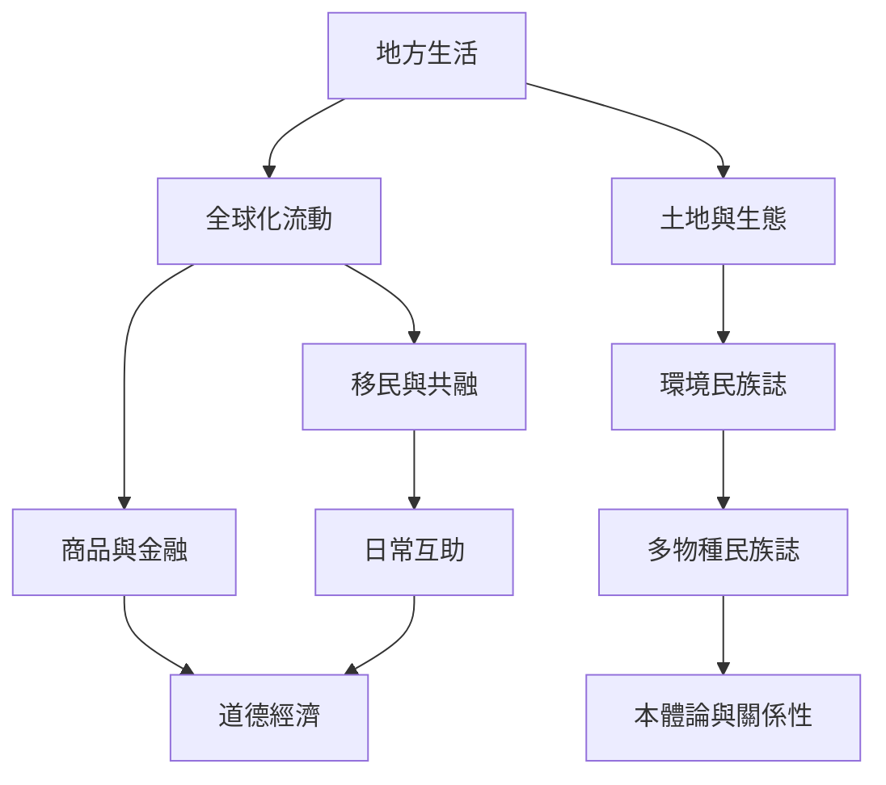

地方生活同時受到全球流動與生態物質條件影響。社會人類學可以追蹤資本、移動、語言、政策與商品如何進入地方，也能讓非人存在者與環境成為分析主體。

概念：[[全球化]]、[[共融性]]、[[多物種民族誌]]、[[本體論]]、[[關係性]]、[[道德經濟]]。

永久筆記：[[全球地方經驗需要放進跨國連結中理解]]、[[地方概念在跨國流動時會被重新詮釋]]、[[人與非人共同構成社會生態世界]]。

區域材料：[[南非移民互助顯示友誼與共生能超越身分分類]]、[[玻利維亞Buen Vivir的意義在地方政治中持續被爭論]]、[[台灣原住民族宗教差異可透過多種本體論理解]]、[[環境民族誌把人類生活放回多物種與物質關係中]]、[[金融民族誌能揭示抽象市場如何塑造日常生活]]。

行動筆記：[[以步行路線記錄城市如何分配舒適與可達性]]、[[以多物種觀察重新理解社區的食物與剩食循環]]。

本地圖連結導讀：[[Social_anthropology]]。
