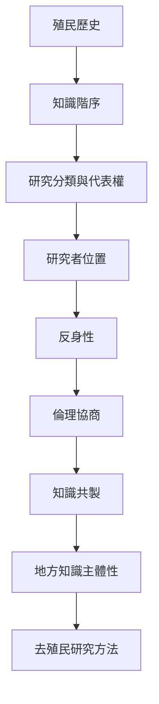

人類學既曾參與殖民知識的分類，也持續反思其學科歷史與當代研究關係。去殖民工作不只是擴大研究案例，而是重新檢視研究問題、資料所有權、詮釋權與成果流通。

概念：[[後殖民主義]]、[[去殖民研究方法]]、[[位置性]]、[[反身性]]、[[知識共製]]、[[文化相對主義]]。

永久筆記：[[去殖民不是增加案例而是重新分配知識權力]]、[[研究者的位置會參與知識的產生]]、[[文化不是群體內部完全一致的固定清單]]。

區域案例：[[去殖民研究方法要求研究者重視原住民族知識主體性]]、[[泰雅長者透過語言山林與Gaga重新協商族群認同]]、[[玻利維亞Buen Vivir的意義在地方政治中持續被爭論]]、[[南亞非規範親屬實踐挑戰殖民行政家庭分類]]。

行動筆記：[[建立社群田野回饋機制讓參與者能改寫研究]]、[[為台灣地方研究建立多語來源清單與作者地圖]]、[[以小型概念展覽呈現不同地方如何定義好生活]]。

本地圖連結導讀：[[Social_anthropology]]。
