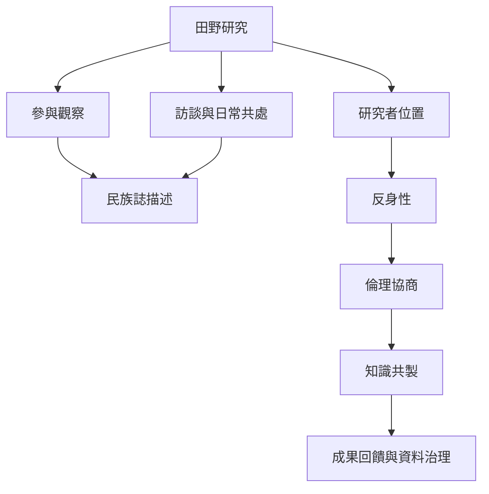

民族誌方法不是單一技術，而是研究者、參與者、機構與地方世界之間持續協商的關係。方法、位置性、倫理與資料治理需要一起設計。

概念：[[民族誌]]、[[參與觀察]]、[[反身性]]、[[位置性]]、[[研究倫理]]、[[知識共製]]。

方法與資料：[[長期參與觀察讓民族誌從地方生活中生成問題]]、[[民族誌把日常經驗連回制度與歷史]]、[[數位民族誌研究線上線下交織的日常生活]]、[[澳洲與亞洲多地的民族誌方法在不確定中持續調整]]。

倫理與權力：[[研究者的位置會參與知識的產生]]、[[研究倫理是持續性的關係責任]]、[[全球南方田野倫理必須在關係中持續協商]]、[[民族誌關係中的互惠與團結可能超出研究程序]]、[[人類學倫理要求不傷害誠實與持續尊重合作關係]]。

行動筆記：[[建立社群田野回饋機制讓參與者能改寫研究]]、[[研究禪修團體時同時觀察沉默身體與制度]]、[[把數位社群當成線上線下混合的田野場域]]。

本地圖連結導讀：[[Social_anthropology]]。
