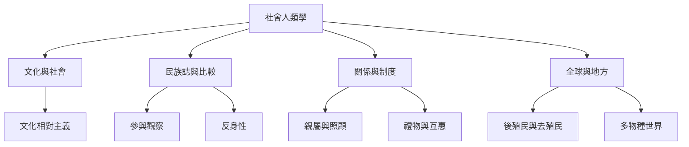

社會人類學以關係、文化、歷史與地方脈絡為分析核心，透過民族誌與比較研究理解人們如何共同生活。這張地圖把學科基礎、分析尺度、區域視角與公共實作串在一起。

學科入口：[[社會人類學]]、[[文化]]、[[社會]]、[[民族誌]]、[[關係性]]。

核心永久筆記：[[社會人類學把熟悉生活變成可研究的問題]]、[[民族誌把日常經驗連回制度與歷史]]、[[關係比孤立個體更能說明社會生活]]、[[文化不是群體內部完全一致的固定清單]]、[[全球地方經驗需要放進跨國連結中理解]]。

區域與比較材料：[[南非移民互助顯示友誼與共生能超越身分分類]]、[[南亞非規範親屬實踐挑戰殖民行政家庭分類]]、[[泰雅長者透過語言山林與Gaga重新協商族群認同]]、[[台灣原住民族宗教差異可透過多種本體論理解]]、[[玻利維亞Buen Vivir的意義在地方政治中持續被爭論]]。

實作延伸：[[把共餐活動當作互助關係而非單純食物交換來觀察]]、[[為台灣地方研究建立多語來源清單與作者地圖]]、[[以小型概念展覽呈現不同地方如何定義好生活]]。

本地圖連結導讀：[[Social_anthropology]]。
