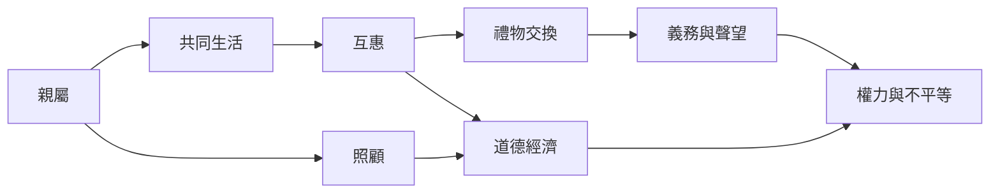

親屬、禮物、互惠與照顧不是自然且固定的制度，而是在具體生活中被實踐、協商和制度化的關係。它們能產生支持，也可能製造依賴與不平等。

概念：[[親屬]]、[[照顧]]、[[互惠]]、[[禮物交換]]、[[道德經濟]]、[[關係性]]。

分析筆記：[[關係比孤立個體更能說明社會生活]]、[[互惠能維繫合作也可能製造義務]]、[[親屬不只由血緣構成也由照顧實作維繫]]。

區域材料：[[禮物交換讓物品承載關係義務與人格觀]]、[[南非移民互助顯示友誼與共生能超越身分分類]]、[[南亞非規範親屬實踐挑戰殖民行政家庭分類]]、[[照顧是由關係制度與物質條件共同組織的實作]]。

行動筆記：[[把共餐活動當作互助關係而非單純食物交換來觀察]]、[[比較不同社群的免費分享制度而不浪漫化互助]]。

本地圖連結導讀：[[Social_anthropology]]。
