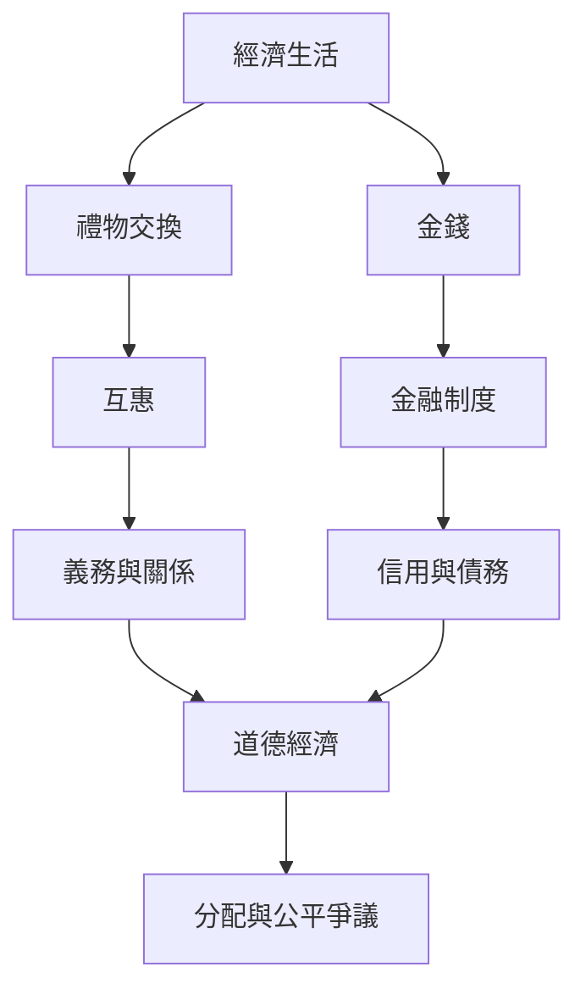

經濟生活並非只由價格與個人效用組成。金錢、禮物、互惠、照顧與道德判準交織，形成不同的資源分配制度。人類學研究的任務，是觀察這些制度如何實際運作、由誰受益，以及它們如何塑造人的關係與時間。

概念：[[金錢]]、[[禮物交換]]、[[互惠]]、[[道德經濟]]、[[照顧]]、[[全球化]]。

永久筆記：[[互惠能維繫合作也可能製造義務]]、[[關係比孤立個體更能說明社會生活]]、[[全球地方經驗需要放進跨國連結中理解]]。

文獻入口：[[禮物交換讓物品承載關係義務與人格觀]]、[[金錢不只是交換媒介也是社會關係與政治象徵]]、[[金融民族誌能揭示抽象市場如何塑造日常生活]]。

行動筆記：[[比較不同社群的免費分享制度而不浪漫化互助]]、[[把共餐活動當作互助關係而非單純食物交換來觀察]]。

本地圖連結導讀：[[Social_anthropology]]。
