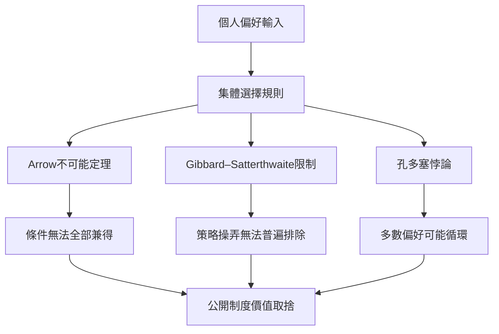

這張地圖把 Arrow 不可能定理、Gibbard–Satterthwaite 定理與孔多塞悖論放在同一架構下：它們分別揭示偏好聚合的一致性限制、策略操弄的限制，以及多數排序可能循環的問題。這些結果不是民主的終結，而是要求制度設計者明確說明假設與取捨。

[[Arrow不可能定理揭示集體偏好聚合的條件衝突]]、[[策略性投票使選民可能不願如實表達偏好]]、[[孔多塞悖論顯示多數偏好可能形成循環]]、[[每次集體決策都應公開選擇規則與代價]]。
