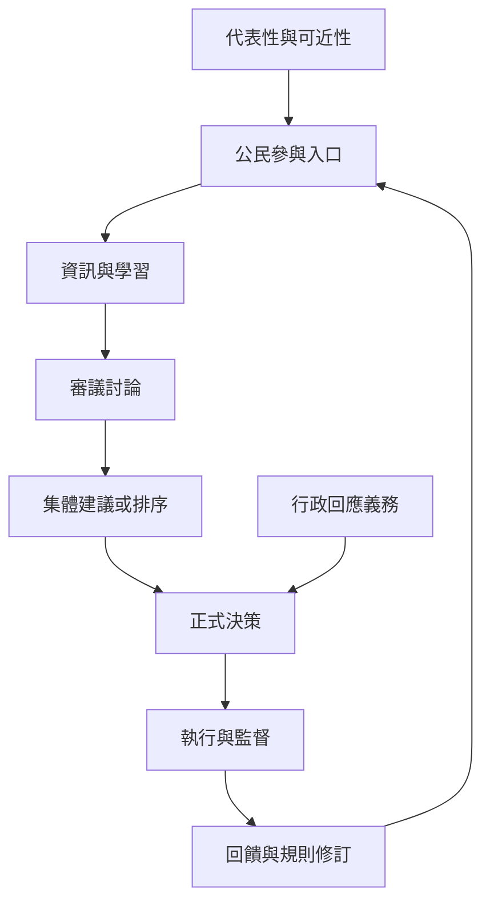

投票只能呈現某一時點的偏好表達；審議與共同治理則讓公民能學習、提出理由、調整偏好，並持續參與規則與資源的執行。參與式預算、代表性審議與數位提案各自處理不同的入口與權力問題，需以全流程的政策回應與分配結果檢驗。

[[審議民主讓偏好在交換理由後得以修正]]、[[參與式預算把集體選擇連接到公共資源分配]]、[[數位參與擴大發聲機會但不自動轉化為決策權]]、[[共同治理不能只計票還要設計規則與責任]]、[[建立社群決策品質的簡單追蹤指標]]。
